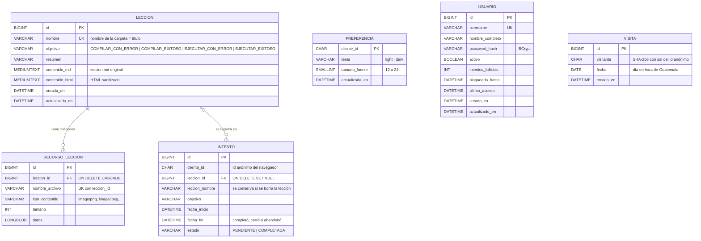
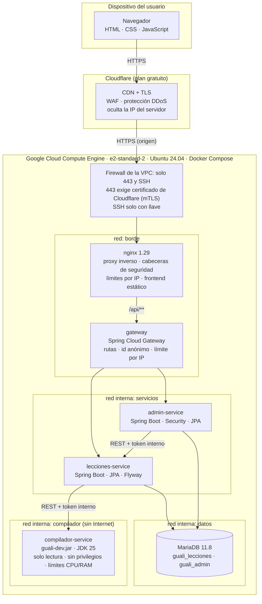

# Diagramas

## Diagrama entidad-relación

Cada microservicio tiene su propia base de datos en MariaDB (patrón *database per service*). No hay llaves foráneas entre bases: lecciones-service y admin-service se comunican por REST.

`INTENTO.cliente_id`, `PREFERENCIA.cliente_id` y el origen de `VISITA.visitante` son el mismo identificador anónimo del navegador, asignado por el gateway en la cookie `guali_cliente`.

## Diagrama de despliegue

