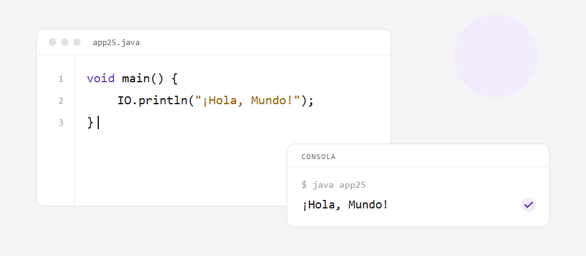

# Hola, Mundo

Todo programador empieza aquí. Vas a escribir un programa que muestra un mensaje en la consola.

En Java 25 un programa puede ser tan corto como un método `main`:

```java
void main() {
    IO.println("¡Hola, Mundo!");
}
```

## Qué hace cada parte

- `void main()` es el punto de entrada: ahí empieza la ejecución.
- `IO.println(...)` imprime el texto y salta a la siguiente línea.
- El punto y coma `;` termina cada instrucción.

## Tu reto

Escribe el programa a mano, compílalo y ejecútalo. Después cambia el mensaje por tu nombre y vuelve a ejecutarlo.

> Fíjate en las mayúsculas: `IO` no es lo mismo que `io`.
